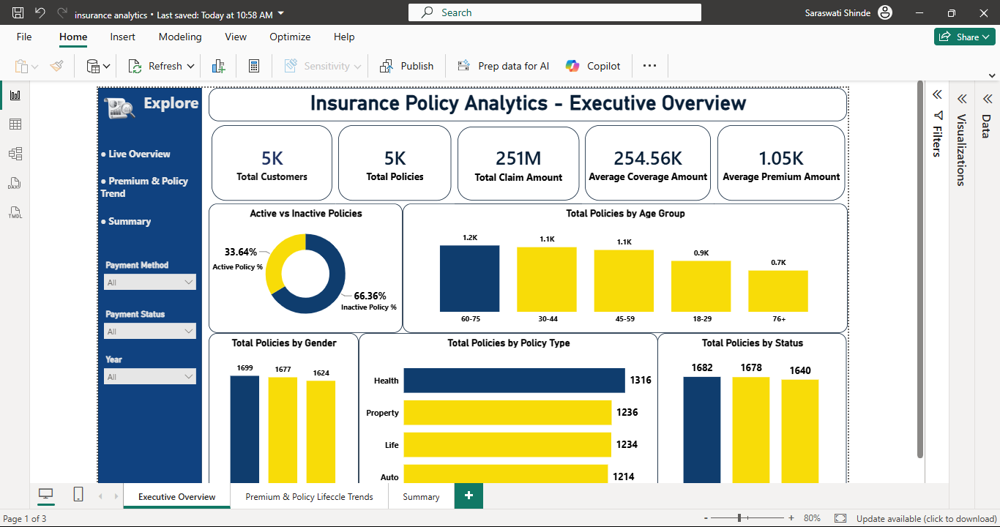
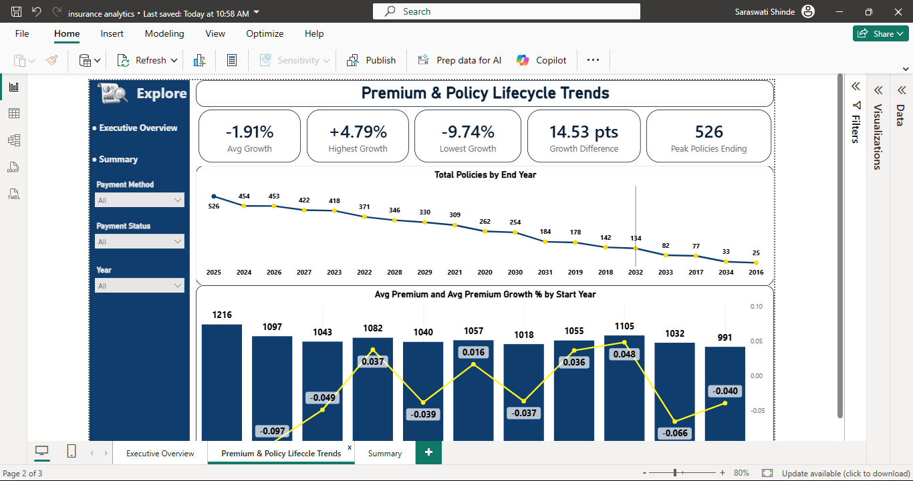
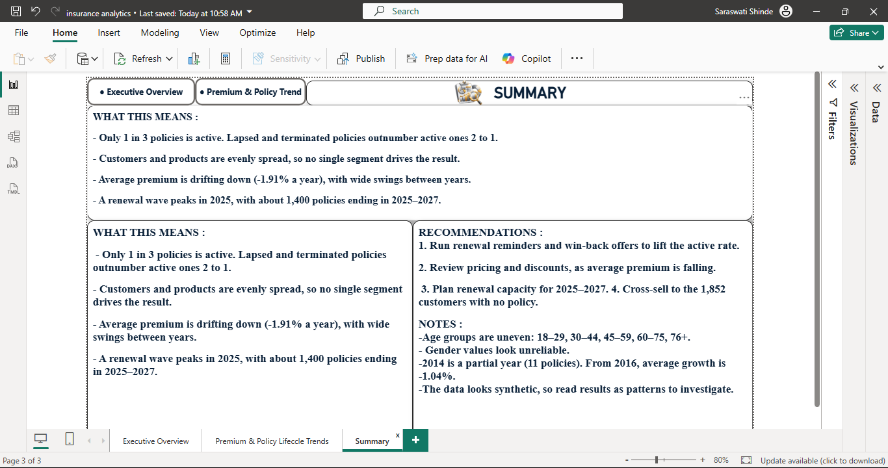

# 📊 Insurance Policy Analytics – Executive Dashboard (SQL + Power BI)

> An end-to-end Business Analytics project that turns raw insurance policy data into an executive-ready Power BI dashboard, backed by MySQL queries, a Business Requirements Document (BRD) and actionable recommendations.


---

## 👩‍💻 Author

| | |
|---|---|
| **Name** | Saraswati Sarjerao Shinde |
| **Role** | Aspiring Business Analyst (Fresher) |
| **Location** | Bengaluru, Karnataka, India |
| **LinkedIn** | [linkedin.com/in/saraswati-shinde](https://www.linkedin.com/in/saraswati-shinde/) |
| **Portfolio** | [saraswatishinde04.github.io/3D_Portfolio](https://saraswatishinde04.github.io/3D_Portfolio/) |
| **GitHub** | [github.com/saraswatishinde04](https://github.com/saraswatishinde04) |
| **Email** | shindesara444@gmail.com |

---

## 📑 Table of Contents

1. [Project Overview](#-project-overview)
2. [Business Problem](#-business-problem)
3. [Objectives](#-objectives)
4. [Tech Stack](#-tech-stack)
5. [Dataset](#-dataset)
6. [Project Workflow](#-project-workflow)
7. [Dashboard Walkthrough](#-dashboard-walkthrough)
8. [Key Insights](#-key-insights)
9. [Recommendations](#-recommendations)
10. [Business Requirements Document (BRD)](#-business-requirements-document-brd)
11. [Data Notes & Limitations](#-data-notes--limitations)
12. [Repository Structure](#-repository-structure)
13. [How to Run This Project](#-how-to-run-this-project)
14. [Skills Demonstrated](#-skills-demonstrated)
15. [Contact](#-contact)

---

## 🎯 Project Overview

This project analyses an insurance company's customer, policy, claims and payment data to give leadership a clear view of **how the policy portfolio is performing**.

The data is stored in a **MySQL** database (`policy_analytics`), queried with SQL to answer **21 defined business KPI questions**, and visualised in a **3-page Power BI report**:

1. **Executive Overview** – portfolio size, policy status, demographics and product mix
2. **Premium & Policy Lifecycle Trends** – premium growth and when policies are due to end
3. **Summary** – plain-English findings, recommendations and data notes

---

## ❓ Business Problem

The insurance business needs to understand:

- How many policies are **actually active**, and why so many are not
- Whether **premiums are growing or shrinking** over time
- **When** large groups of policies will reach their end date (renewal workload and revenue risk)
- Which **customer segments and products** drive the portfolio
- Where there are **untapped customers** (customers with no policy)

Without a single consolidated view, these questions are slow to answer and decisions are made on partial information.

---

## 🧭 Objectives

- Build a single **executive dashboard** that answers all 21 KPI questions
- Measure **active vs inactive** policy share and identify the retention gap
- Track **average premium and premium growth** by policy start year
- Forecast the **renewal wave** using policy end years
- Segment the portfolio by **age group, gender, policy type and status**
- Provide **clear, data-backed recommendations** for leadership

---

## 🛠 Tech Stack

| Layer | Tool |
|---|---|
| Source data | Microsoft Excel (`Policy_Data.xlsx`) |
| Database & querying | MySQL (database: `policy_analytics`) |
| Modelling & visualisation | Power BI Desktop (data modelling, DAX, slicers, navigation) |
| Documentation | Markdown, BRD |

---

## 🗂 Dataset

Source file: `Policy_Data.xlsx`, loaded into MySQL and connected to Power BI.

| Sheet / Table | Description |
|---|---|
| Customer Information | Customer demographics (age, gender, etc.) |
| Policy Details | Policy type, status, coverage, premium, start and end dates |
| Claims | Claim records and amounts |
| Payment History | Payment method and payment status |
| Additional Fields | Supporting attributes |

**Scale:** ~5,000 customers and ~5,000 policies. The data appears to be **synthetic**, so results should be read as patterns to investigate rather than real-world conclusions.

---

## 🔄 Project Workflow

```
Policy_Data.xlsx ──► MySQL (policy_analytics) ──► SQL KPI queries (21 questions)
                                   │
                                   ▼
                        Power BI data model
                  (relationships, DAX measures, slicers)
                                   │
                                   ▼
          3-page dashboard: Overview → Trends → Summary
                                   │
                                   ▼
              Insights, recommendations and BRD
```

1. **Data understanding** – reviewed all sheets, keys and data quality
2. **Database setup** – loaded data into MySQL (`policy_analytics`)
3. **SQL analysis** – wrote queries for all 21 KPI questions (including premium growth as share of total premium and year-over-year)
4. **Data modelling** – connected Power BI to MySQL, built relationships between tables
5. **DAX measures** – created KPIs such as total customers, total policies, total claim amount, average coverage and average premium, growth %
6. **Dashboard design** – built navigation, slicers (Payment Method, Payment Status, Year) and consistent navy/yellow theme
7. **Insight generation** – summarised findings and recommendations

---

## 🖥 Dashboard Walkthrough

> 📌 Save your screenshots in the `images/` folder using the file names below so they display here.

### Page 1 – Executive Overview


**KPI cards**

| KPI | Value |
|---|---|
| Total Customers | 5K |
| Total Policies | 5K |
| Total Claim Amount | 251M |
| Average Coverage Amount | 254.56K |
| Average Premium Amount | 1.05K |

**Visuals:** Active vs Inactive Policies (donut), Total Policies by Age Group, by Gender, by Policy Type and by Status (Active 1,682 · Terminated 1,678 · Lapsed 1,640).
**Slicers:** Payment Method, Payment Status, Year.

### Page 2 – Premium & Policy Lifecycle Trends


| KPI | Value |
|---|---|
| Avg Growth | -1.91% |
| Highest Growth | +4.79% |
| Lowest Growth | -9.74% |
| Growth Difference | 14.53 pts |
| Peak Policies Ending | 526 |

**Visuals:** Total Policies by End Year (line), Avg Premium and Avg Premium Growth % by Start Year (combo chart).

### Page 3 – Summary


Plain-English "What this means", Recommendations and Notes for decision makers.

---

## 💡 Key Insights

| # | Insight | Evidence |
|---|---|---|
| 1 | **Only 1 in 3 policies is active.** Lapsed and terminated policies outnumber active ones 2 to 1. | Active 1,682 (33.64%), Terminated 1,678, Lapsed 1,640 (66.36% inactive) |
| 2 | **No single segment drives the result.** Customers and products are evenly spread. | Health 1,316, Property 1,236, Life 1,234, Auto 1,214 |
| 3 | **Average premium is drifting down** (-1.91% a year) with wide swings between years. | Growth ranges from -9.74% to +4.79% (14.53 pts gap) |
| 4 | **A renewal wave peaks in 2025.** About 1,400 policies end between 2025 and 2027. | 526 (2025), 453 (2026), 422 (2027) |
| 5 | **Untapped customers exist.** 1,852 customers have no policy. | Cross-sell opportunity |
| 6 | **Age groups are uneven.** The 60-75 group is the largest. | 60-75: 1.2K, 30-44: 1.1K, 45-59: 1.1K, 18-29: 0.9K, 76+: 0.7K |

---

## ✅ Recommendations

1. **Run renewal reminders and win-back offers** to lift the active policy rate.
2. **Review pricing and discounts**, as average premium is falling.
3. **Plan renewal capacity for 2025–2027** (staffing, outreach, systems) to handle the peak.
4. **Cross-sell to the 1,852 customers with no policy.**

---

## 📄 Business Requirements Document (BRD)

The complete BRD is available here: **[docs/BRD.docx](docs/BRD.docx)** (Word) and **[docs/BRD.md](docs/BRD.md)** (readable on GitHub).

| Section | Covered |
|---|---|
| Business problem & objectives | 5 business objectives (BO-01 to BO-05) |
| Scope | In-scope and out-of-scope items |
| Stakeholders | Executives, Sales & Marketing, Renewals/Operations, Pricing |
| Requirements | 8 business, 11 functional and 7 non-functional requirements |
| KPI definitions | 10 KPIs with formulas |
| Governance | Assumptions, constraints, risks, acceptance criteria |
| Traceability | Objective → Requirement → Dashboard element matrix |

---

## ⚠️ Data Notes & Limitations

- Age groups are uneven in size: 18–29, 30–44, 45–59, 60–75, 76+.
- Gender values look unreliable and should not drive decisions.
- 2014 is a partial year (11 policies). From 2016 onwards, average premium growth is **-1.04%**.
- The data looks synthetic, so read results as patterns to investigate.

---

## 📁 Repository Structure

```
insurance-policy-analytics/
│
├── README.md                      # Project documentation
├── LICENSE                        # MIT License
├── .gitignore
│
├── data/
│   └── Policy_Data.xlsx           # Source dataset (5 sheets, 5,000 rows each)
│
├── docs/
│   ├── BRD.docx                   # Business Requirements Document (Word)
│   ├── BRD.md                     # Same BRD, readable on GitHub
│   └── data_dictionary.md         # Tables, columns and relationships
│
├── sql/
│   └── policy_analytics_kpis.sql  # SQL for the 21 KPI questions (replace with your final file)
│
├── powerbi/
│   └── README.md                  # Add insurance_analytics.pbix here
│
└── images/
    ├── 01_executive_overview.png
    ├── 02_premium_policy_trends.png
    └── 03_summary.png
```

---

## ▶️ How to Run This Project

1. **Clone the repository**
   ```bash
   git clone https://github.com/saraswatishinde04/insurance-policy-analytics.git
   cd insurance-policy-analytics
   ```
2. **Set up the database** – create the `policy_analytics` database in MySQL and load the five sheets from `data/Policy_Data.xlsx` (see `docs/data_dictionary.md`).
3. **Run the SQL** – execute `sql/policy_analytics_kpis.sql` to get the answers to the 21 KPI questions.
4. **Open the report** – open `powerbi/insurance_analytics.pbix` in Power BI Desktop.
5. **Update the data source** – *Home → Transform data → Data source settings*, then point it to your MySQL server and the `policy_analytics` database.
6. **Refresh** and explore the three pages.

---

## 🧰 Skills Demonstrated

- Business Requirements Document (BRD) writing
- Functional and non-functional requirements
- KPI definition and stakeholder analysis
- Root cause analysis (why only 1 in 3 policies is active)
- SQL (MySQL) – joins, aggregations, window functions for growth
- Power BI – data modelling, DAX, slicers, navigation, storytelling
- Data quality assessment and clear communication of limitations

---

## 📬 Contact

**Saraswati Sarjerao Shinde**
Aspiring Business Analyst | Bengaluru, India

- 🔗 LinkedIn: [linkedin.com/in/saraswati-shinde](https://www.linkedin.com/in/saraswati-shinde/)
- 🌐 Portfolio: [saraswatishinde04.github.io/3D_Portfolio](https://saraswatishinde04.github.io/3D_Portfolio/)
- 💻 GitHub: [github.com/saraswatishinde04](https://github.com/saraswatishinde04)
- 📧 Email: shindesara444@gmail.com

⭐ If you found this project useful, feel free to star the repository!
